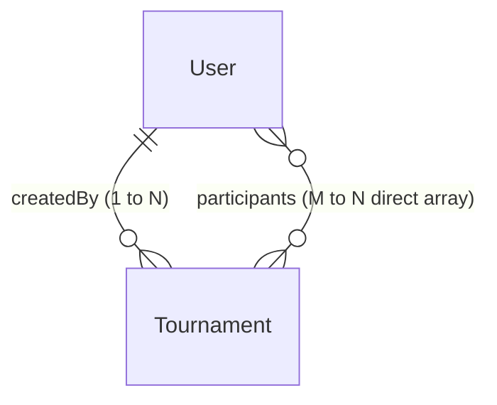
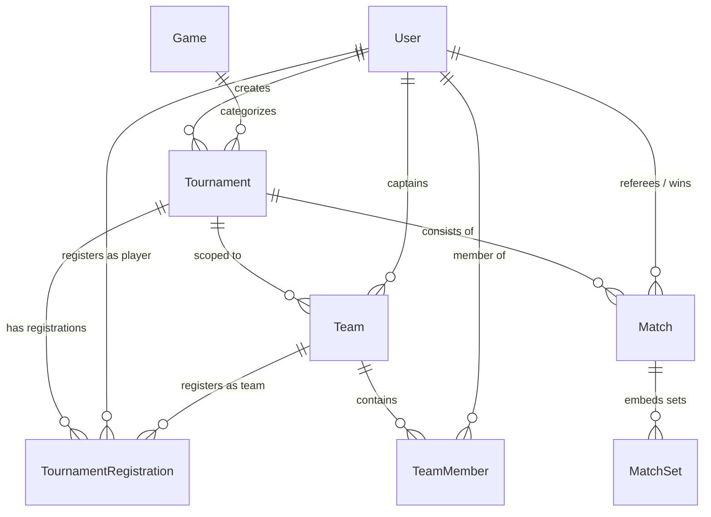

# Database Context & Architectural Analysis

> **Project**: Tournament Tracker (`apps/gateway`)  
> **Database Engine**: MongoDB (Mongoose ODM in NestJS Code-First GraphQL)  
> **Documentation Target**: Comprehensive Schema State, Cross-Entity Relationships, Gap Analysis & Strategic Evolution Roadmap.

---

## 1. Executive Summary & Current Database State

The database currently consists of **two active Mongoose collections** implemented in `apps/gateway`:
1. **`users`** (`User` schema in `apps/gateway/src/app/modules/user/schemas/user.schema.ts`)
2. **`tournaments`** (`Tournament` schema in `apps/gateway/src/app/modules/tournament/schemas/tournament.schema.ts`)

In addition, an architectural target document exists at [docs/architecture/database-schema.md](file:///d:/learnings/org/docs/architecture/database-schema.md), which outlines 6 prospective collections (`users`, `tournaments`, `games`, `teams`, `registrations`, `matches`).

---

## 2. In-Depth Schema Definitions (Active MongoDB Collections)

### 2.1 Collection: `users`
- **Mongoose Model**: `User`
- **Options**: `{ timestamps: true }` (generates `createdAt` and `updatedAt`)
- **Key Characteristics**: Supports soft deletion, authentication data, employee references, and RBAC roles.

| Field Name | Type | Constraints / Defaults | Index | Notes / Purpose |
| :--- | :--- | :--- | :---: | :--- |
| `_id` | `ObjectId` | Auto-generated PK | Primary | MongoDB Document ID |
| `firstName` | `String` | Required, `trim: true` | No | Given name |
| `lastName` | `String` | Required, `trim: true` | No | Family name |
| `fullName` | `String` | Required, `trim: true` | No | Pre-computed concatenation stored in DB |
| `email` | `String` | Required, Unique, Lowercase, Trim | `{ email: 1 }` (Unique) | Primary login identifier |
| `password` | `String` | Required, `minlength: 6`, `select: false` | No | Bcrypt hash; excluded from queries by default |
| `phoneNumber` | `String` | Optional, `default: null` | No | User phone number |
| `role` | `String` | Enum: `UserRole`, `default: 'member'` | `{ role: 1 }` | `admin`, `referee`, `player`, `member` |
| `avatar` | `String` | Optional, `default: null` | No | URL to cloud avatar asset |
| `bio` | `String` | Optional, `default: null` | No | Biography text |
| `isEmailVerified` | `Boolean` | `default: false` | No | Verification flag |
| `isActive` | `Boolean` | `default: true` | `{ isActive: 1 }` | Account active state |
| `refreshToken` | `String` | Optional, `default: null`, `select: false`| No | Hashed JWT refresh token |
| `employeeId` | `String` | Optional, `default: null`, `select: false`| No | Organizational employee identifier |
| `emailVerifiedAt` | `Date` | Optional, `default: null` | No | Verification timestamp |
| `lastLoginAt` | `Date` | Optional, `default: null` | No | Login tracking |
| `isDeleted` | `Boolean` | `default: false` | `{ isDeleted: 1 }` | Soft-delete flag (filtered in queries) |
| `deletedAt` | `Date` | Optional, `default: null` | No | Soft-delete timestamp |
| `createdAt` | `Date` | Mongoose timestamps | `{ createdAt: 1 }` | Record creation timestamp |
| `updatedAt` | `Date` | Mongoose timestamps | No | Record update timestamp |

---

### 2.2 Collection: `tournaments`
- **Mongoose Model**: `Tournament`
- **Options**: `{ timestamps: true }`
- **Key Characteristics**: Central domain entity; tracks lifecycle, registration deadlines, and player/match references.

| Field Name | Type | Constraints / Defaults | Index | Notes / Purpose |
| :--- | :--- | :--- | :---: | :--- |
| `_id` | `ObjectId` | Auto-generated PK | Primary | MongoDB Document ID |
| `name` | `String` | Required, `trim: true` | No | Tournament title |
| `description` | `String` | Optional, `default: null`, `trim: true` | No | Details and tournament rules |
| `category` | `String` | Optional, `default: null`, `trim: true` | No | Sport or game category |
| `type` | `String` | Enum: `TournamentType` (`online`, `offline`) | `{ type: 1 }` | Event venue format |
| `format` | `String` | Enum: `TournamentFormat` (`single_elimination`, `double_elimination`, `round_robin`, `league`) | No | Tournament bracket/round structure |
| `visibility` | `String` | Enum: `TournamentVisibility` (`public`, `private`) | `{ visibility: 1 }` | Access privacy |
| `bannerImage` | `String` | Optional, `default: null` | No | Cover/banner asset URL |
| `maxPlayers` | `Number` | Optional, `default: null` | No | Max individual/team slots |
| `prizePool` | `Number` | Optional, `default: null` | No | Cash or point prize pool |
| `startDate` | `Date` | Required | `{ startDate: 1 }` | Tournament commencement |
| `endDate` | `Date` | Required | No | Expected completion date |
| `registrationDeadline` | `Date` | Required | No | Cutoff for tournament join requests |
| `createdBy` | `ObjectId` | Ref: `User`, Required | `{ createdBy: 1 }` | Admin/Organizer who created it |
| `participants` | `[ObjectId]` | Ref: `User`, `default: []` | No | Direct array of user IDs registered |
| `matches` | `[ObjectId]` | Ref: `Match`, `default: []` | No | References to matches (pending match schema) |
| `status` | `String` | Enum: `TournamentStatus` (`draft`, `upcoming`, `active`, `completed`, `cancelled`), `default: 'draft'` | `{ status: 1 }` | Tournament lifecycle phase |
| `isDeleted` | `Boolean` | `default: false` | `{ isDeleted: 1 }` | Soft-deletion flag |
| `deletedAt` | `Date` | Optional, `default: null` | No | Deletion timestamp |
| `createdAt` | `Date` | Mongoose timestamps | `{ createdAt: 1 }` | Timestamp |
| `updatedAt` | `Date` | Mongoose timestamps | No | Timestamp |

---

## 3. Entity-Relationship Model (Current vs Target)

### Current Implemented ERD

### Architecture Target ERD (from [database-schema.md](file:///d:/learnings/org/docs/architecture/database-schema.md))

---

## 4. Comprehensive Architectural Analysis & Identified Gaps

### Issue 1: High Risk of Document Overflow in `Tournament.participants` & `Tournament.matches`
- **Current Pattern**: Arrays of ObjectIds (`participants: Types.ObjectId[]`, `matches: Types.ObjectId[]`) inside the `Tournament` document.
- **Problem**: 
  - MongoDB has a hard 16MB document limit.
  - Adding 500+ participants and dozens of match IDs into a single document causes high write contention and document growth reallocation penalties.
  - Searching participant status or approval details is difficult when using a bare array of IDs.
- **Recommendation**: Introduce a separate `TournamentRegistration` (or `Participant`) collection with index on `{ tournamentId: 1, userId: 1 }`.

### Issue 2: Direct Reference to Non-Existent `Match` Schema
- **Current Pattern**: `Tournament.matches` has `ref: 'Match'`, but no `Match` Mongoose schema or collection exists in `apps/gateway`.
- **Problem**: Any attempt to populate `matches` will throw a runtime Mongoose `MissingSchemaError`.
- **Recommendation**: Create the formal `Match` module and schema (`matches` collection) or temporarily remove the dangling `ref: 'Match'`.

### Issue 3: Discrepancy Between User Schema and Architecture Documentation
- In the active `user.schema.ts`, `role` is stored as lowercase string (`'admin'`, `'referee'`, `'player'`, `'member'`), whereas `database-schema.md` defines uppercase enums (`ADMIN`, `REFEREE`, `PLAYER`, `MEMBER`).
- In GraphQL resolvers and client queries, both styles exist in different places (e.g., GraphQL enum returns uppercase, Mongoose stores lowercase).
- **Recommendation**: Unify on uppercase string enums across DB, GraphQL, and frontend.

### Issue 4: Missing Index on Compound Queries & Search
- `UsersService.findAll` runs text queries on `fullName`, `email`, and `phoneNumber` with `$regex`.
- As user volume increases, regex queries will trigger full-collection scans without text or compound indexes.
- **Recommendation**:
  - Add text index: `UserSchema.index({ fullName: 'text', email: 'text' })`
  - Add compound index: `UserSchema.index({ isDeleted: 1, createdAt: -1 })` for paginated queries.
  - For tournaments: `TournamentSchema.index({ isDeleted: 1, status: 1, startDate: 1 })`.

### Issue 5: Missing `Game` / Sport Dimension
- `Tournament.category` is currently a loose string.
- The target architecture specifies a dedicated `Game` entity (e.g., FIFA, Valorant, Table Tennis, Chess) which defines team sizes, rule templates, and scoring mechanisms.
- **Recommendation**: Promote `category` to a dedicated `Game` collection or embedded document schema.

---

## 5. Suggested Database Evolution Plan

Here is the proposed 3-phase roadmap for community discussion and approval:

### Phase 1: Harden Existing Schemas (Immediate / Zero-Breaking)
1. **Unify Enums**: Align `UserRole`, `TournamentStatus`, `TournamentFormat` across Mongoose, GraphQL, and client filters.
2. **Optimize Query Indexes**:
   - Add `{ isDeleted: 1, createdAt: -1 }` on `users`.
   - Add `{ isDeleted: 1, status: 1, startDate: -1 }` on `tournaments`.
3. **Safety Guards**: Remove or conditionalize `ref: 'Match'` until the Match module is constructed.

### Phase 2: Core Domain Expansion (Registrations & Matches)
1. **`TournamentRegistration` Collection**:
   - Fields: `tournamentId`, `userId`, `teamId`, `status` (`PENDING`, `APPROVED`, `REJECTED`, `WITHDRAWN`), `registeredAt`, `metadata`.
   - Unique index: `{ tournamentId: 1, userId: 1 }` (prevents double registrations).
2. **`Match` Collection**:
   - Fields: `tournamentId`, `round`, `matchNumber`, `competitorAId`, `competitorBId`, `scoreA`, `scoreB`, `status`, `refereeId`, `winnerId`, embedded `sets[]`.

### Phase 3: Team Tournaments & Game Catalogs (Advanced)
1. **`Game` Collection**: Centralizes game rules, scoring formats, and min/max team constraints.
2. **`Team` & `TeamMember` Collections**: Enables squad-based tournament participation and captain assignment.

---

## 6. Discussion Points for Next Step

1. **Enum Convention**: Standardize on uppercase (e.g. `ADMIN`, `PLAYER`) or lowercase (`admin`, `player`) across MongoDB?
2. **Registration Architecture**: Move `Tournament.participants: ObjectId[]` to a dedicated `TournamentRegistration` collection now, or keep the array for simple 1-player events?
3. **Next Feature Priority**: Implement the **Match** module first (to power the Matches frontend page) or **Tournament Registration Flow**?
